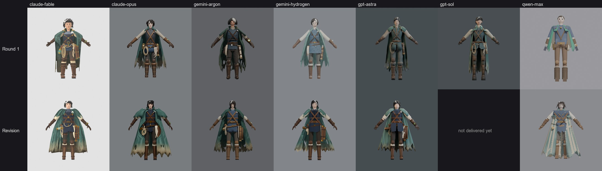
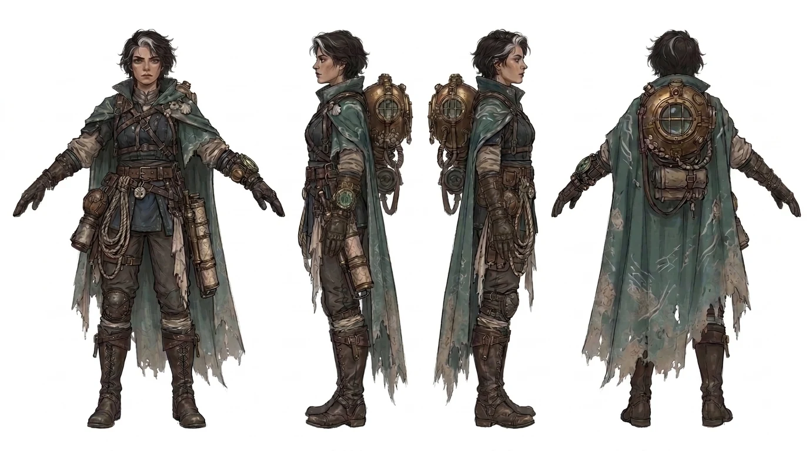

# Blender model contest

A head-to-head test of AI models doing 3D art in Blender **through code only**: every contestant gets the same reference image, the same written brief, the same link to Blender and the same time limit. Everything a model produced is here: its step files, its renders, its notes and its exported model.



The reference all of them worked from:



## Why

Vendors say their models can work alone in Blender. We found no independent, like-for-like comparison, so we ran one. The contest is run by [LSGames Studio](https://akerith.github.io), a one-person game studio in Italy, to decide which model to use for game art.

## Status (19 November 2026)

The contest is still running. This repository is updated after each round.

| Project | Round 1 | Revision round |
|---|---|---|
| 1. Character (`personaggio`) | done by 7 contestants | done by 6, `gpt-sol` in progress |
| 2. Weapon (`arma`) | not started | - |
| 3. Walkable scene (`scena`) | not started | - |

Two more contestants (GPT 6.2 Astra and GPT 6.2 Sol) are queued for project 1. The blind judging by the owner has not happened yet: this repository holds measurements and raw output, not a ranking.

## Contestants

| Name in the contest | Model | Program that drives it |
|---|---|---|
| `claude-opus` | Claude Opus 5.5 | Claude Code |
| `claude-fable` | Claude Fable 5.2 | Claude Code |
| `gpt-astra` | GPT 6 Astra | Codex CLI |
| `gpt-sol` | GPT 6.1 Sol | Codex CLI |
| `gemini-argon` | Gemini 4 Argon | Antigravity CLI |
| `gemini-hydrogen` | Gemini 4 Hydrogen | Antigravity CLI |
| `qwen-max` | Qwen 4 Max | Qwen Code |

## How a run works

1. The owner opens the model's own command-line program in the contest folder and pastes the setup prompt ([PROMPT-1-AMBIENTE.md](PROMPT-1-AMBIENTE.md)). The model reads the rules ([REGOLE.md](REGOLE.md)) and starts Blender through the kit.
2. The project prompt is pasted ([PROMPT-2-PERSONAGGIO.md](PROMPT-2-PERSONAGGIO.md)). The model has 2 hours.
3. The model writes plain Blender Python files and runs them one at a time with `kit/gara.py passo`. Each step can render the scene from six fixed cameras; the model looks at its own renders and corrects its work. Nothing may be downloaded: geometry, materials and textures are all made with code.
4. Delivery: a `.blend`, a `.glb` for Unity, six final renders and a notes file.
5. After everyone has finished round 1, there is **one** revision round of 1 hour with a very detailed prompt, the same for everyone, written from the reference and not from any model's mistakes ([REVISIONE-1-PERSONAGGIO.md](REVISIONE-1-PERSONAGGIO.md)). Each model reopens its own saved file and edits it.

Round 1 ran at medium reasoning effort, the revision at the highest level each program offers. The exceptions are listed in [RESULTS.md](RESULTS.md).

## Results so far

Numbers for project 1 are in [RESULTS.md](RESULTS.md): time, tokens, list-price cost, triangles and bones for both rounds.

Per contestant, under `results/1-personaggio/<name>/`:

- `round1/` and `revision/` - the six final renders, the contestant's own notes (in Italian, as the rules ask) and the exported `.glb`;
- `steps/run1`, `run2`, ... - every step file exactly as it ran inside Blender, oldest run first (a new run starts each time Blender is reopened; the first one is usually the setup test);
- `sources/` - the contestant's own working files, including the libraries its steps import.

One early observation, not a verdict: with code alone, every model handles hard shapes (helmet, belts, boots) far better than organic ones (face, hair, hands, cloth), and a very detailed prompt fixes proportions and placement more than it fixes those.

## Run it yourself

You need Windows, Python 3 and Blender 5.2 (the path is the `BLENDER` constant at the top of `kit/gara.py`).

```bash
python -I kit/gara.py avvia myname
```

```bash
python -I kit/gara.py passo myname path/to/step.py
```

`avvia` opens Blender linked to `concorrenti/myname/`, `passo` runs one step file in it and prints the log, `stato` says whether the link is up. Inside a step file you have `bpy`, `log(...)`, `render_viste("name")` and `OUTBOX`. Then give your model the prompts above with its name in place of `NAME`.

File and command names are in Italian because the contest is run in Italian: `avvia` = start, `passo` = step, `stato` = status, `concorrenti` = contestants, `lavoro` = work, `riferimenti` = references, `REGOLE` = rules, `giro` = round.

## Limits of this test

- **One run per model per round.** No repeats, so no measure of how much a model varies from run to run.
- **Different programs.** Each model runs in its vendor's own command-line program, with that program's system prompt, tools and sandbox. The contest compares model plus program, not the bare model.
- **Reasoning effort is not perfectly equal.** Programs offer different levels; see RESULTS.md.
- **Costs are estimates.** They are what each session would cost at pay-as-you-go list prices; some prices come from third-party listing sites, and the automatic reviewer models some programs use are not counted.
- **Lighting differs in some final renders.** Two contestants changed the scene lighting in the revision. All models will be re-rendered with the same lights before judging.
- **Who wrote the test.** The kit, the rules and the prompts were written with Claude Code, and two contestants are Claude models. The prompts are published here so anyone can check them for bias. Judging is done by a person, with the names hidden.
- The Windows user name in paths has been replaced by `USER`. Nothing else in the contestants' files was edited.

## Licence

Code in `kit/` is under the [MIT licence](LICENSE). Everything else (rules, prompts, reference images, renders, notes, models and step files) is under [CC BY 4.0](LICENSE-CONTENT.md).
